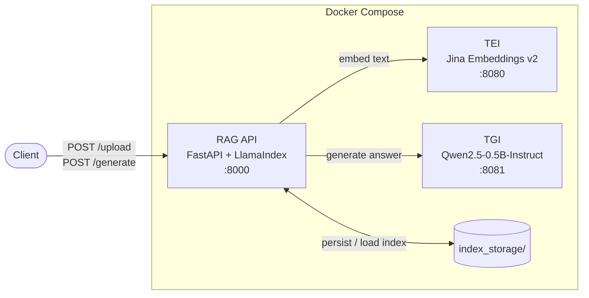

# Emerging Topics RAG

A Retrieval-Augmented Generation (RAG) API built with **FastAPI** and **LlamaIndex**. It embeds documents with **Jina Embeddings v2** (served by Hugging Face Text Embeddings Inference) and answers questions with **Qwen2.5-0.5B-Instruct** (served by Hugging Face Text Generation Inference). Everything runs locally with Docker Compose.

## Contents

- [Architecture](#architecture)
- [Models](#models)
- [Project structure](#project-structure)
- [Getting started](#getting-started)
- [API reference](#api-reference)
- [Configuration](#configuration)
- [Testing](#testing)
- [Notes](#notes)

## Architecture



| Service | Image | Role | Host port |
|---------|-------|------|-----------|
| `tei` | `ghcr.io/huggingface/text-embeddings-inference:cpu-1.6` | Computes text embeddings | `8080` |
| `tgi` | `ghcr.io/huggingface/text-generation-inference:3.1.0` | Generates answers from retrieved context | `8081` |
| `rag` | Built from this repo's `Dockerfile` | Indexing, retrieval and prompt construction | `8000` |

**How a request flows**

1. **`/upload`**: texts are split into sentence windows (`SentenceWindowNodeParser`), embedded through TEI, stored in a `VectorStoreIndex`, and saved to `index_storage/`.
2. **`/generate`**: the question is embedded and the 10 most similar nodes are retrieved. They are wrapped in `<doc>` tags, formatted with Qwen's chat template, and sent to TGI to produce the answer.

## Models

| Purpose | Model | Notes |
|---------|-------|-------|
| Embeddings | [`jinaai/jina-embeddings-v2-base-es`](https://huggingface.co/jinaai/jina-embeddings-v2-base-es) | Bilingual Spanish/English, 768-dim, 8192-token context |
| Generation | [`Qwen/Qwen2.5-0.5B-Instruct`](https://huggingface.co/Qwen/Qwen2.5-0.5B-Instruct) | Small instruction-tuned LLM, runs on CPU |

You can swap either model with an environment variable (see [Configuration](#configuration)).

## Project structure

```
.
├── api_rag.py           # FastAPI app: /upload, /generate, health check
├── test_rag.py          # End-to-end smoke test against a running stack
├── Dockerfile           # Image for the RAG API service
├── docker-compose.yaml  # TEI + TGI + RAG API services
├── requirements.txt     # Python dependencies for the API
└── README.md
```

These folders are created at runtime and ignored by git:

| Folder | Contents |
|--------|----------|
| `tei_data/` | Cached embedding model weights |
| `tgi_data/` | Cached generation model weights |
| `index_storage/` | Persisted vector index |
| `data/` | Optional data mounted into the API container |

## Getting started

### Prerequisites

- [Docker](https://docs.docker.com/get-docker/) with [Docker Compose v2](https://docs.docker.com/compose/)
- Roughly 10–15 GB of free disk space for the Docker images and model weights

### Run

```sh
git clone https://github.com/azrambo/emerging-topics-rag.git
cd emerging-topics-rag

docker compose up -d --build
```

The first start downloads both models, which can take a few minutes. Follow progress with:

```sh
docker compose logs -f
```

The API is ready when this returns:

```sh
curl http://localhost:8000/
# {"message":"RAG API is running successfully"}
```

### Stop

```sh
docker compose down
```

## API reference

### `GET /`

Health check.

### `POST /upload`

Builds (or replaces) the vector index from a list of texts.

```sh
curl -X POST http://localhost:8000/upload \
     -H "Content-Type: application/json" \
     -d '{"texts": ["La capital de Francia es París.", "Python fue creado por Guido van Rossum."]}'
```

```json
{ "message": "Vector index successfully created", "nodes_count": 2 }
```

### `POST /generate`

Answers a question using only the indexed documents.

```sh
curl -X POST http://localhost:8000/generate \
     -H "Content-Type: application/json" \
     -d '{"new_message": {"role": "user", "content": "¿Cuál es la capital de Francia?"}}'
```

```json
{
  "generated_text": "La capital de Francia es París.",
  "contexts": ["La capital de Francia es París.", "..."]
}
```

`contexts` lists the retrieved passages the answer was grounded on.

| Status | Meaning |
|--------|---------|
| `400` | `new_message.content` is missing, or `/upload` received no texts |
| `500` | Indexing or generation failed (e.g. no index uploaded yet, or TEI/TGI still starting) |

## Configuration

Both models can be overridden with environment variables, set in your shell or in a `.env` file next to `docker-compose.yaml`:

| Variable | Default | Used by |
|----------|---------|---------|
| `TEI_MODEL` | `jinaai/jina-embeddings-v2-base-es` | `tei` service and `api_rag.py` |
| `TGI_MODEL` | `Qwen/Qwen2.5-0.5B-Instruct` | `tgi` service and `api_rag.py` (tokenizer) |

```sh
TGI_MODEL=Qwen/Qwen2.5-1.5B-Instruct docker compose up -d
```

Generation settings live in `api_rag.py`: `max_new_tokens=128`, `temperature=0.1`, `top_p=0.8` and `similarity_top_k=10`.

## Testing

`test_rag.py` uploads three sample Spanish documents and asks a question about each:

```sh
pip install requests
python test_rag.py
```

## Notes

- **Language:** the embedding model and system prompt are tuned for Spanish. English also works, since the Jina model is bilingual.
- **Apple Silicon:** the TEI and TGI images are `linux/amd64` only and run under emulation, so expect slower inference.
- **Single index:** each `/upload` replaces the previous index; it doesn't add to it.
